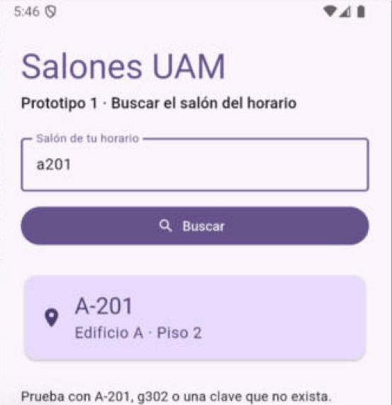
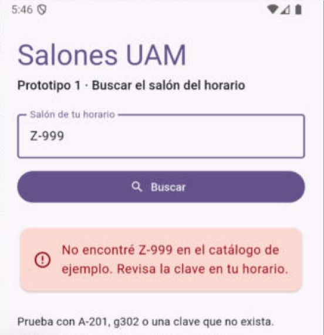

# navegacion-uam-equipo-00

**Salones UAM · Prototipo 1: buscar el salón del horario**

| | |
|---|---|
| Equipo | 00 · repositorio de ejemplo del profesor (tu equipo escribe aquí integrantes y matrículas) |
| UEA | Administración de Proyectos de Software (1151055) · UAM Azcapotzalco |
| Profesor | M. en C. Gabriel Hurtado Avilés |
| Trimestre | 26-O |
| Versión | `v0.1.0` · Prototipo 1 · 15 de octubre de 2026 |

## Introducción

Un alumno de nuevo ingreso tiene su horario, pero no sabe dónde está el salón que dice. El objetivo del proyecto es que una persona que nunca ha estado en la UAM llegue sola a su salón, guiada con realidad aumentada, realidad virtual o ambas.

La app se construye con **prototipos** (ver [docs/prototipos.md](docs/prototipos.md)). Este repositorio contiene el **Prototipo 1**: escribir la clave del salón como viene en el horario y ver su edificio y piso, con mensajes claros cuando la clave no existe. Todavía no hay ruta, cámara ni AR.

El mismo prototipo está hecho dos veces para que sirva de base a cualquier equipo:

| Carpeta | Tecnología | Basada en |
|---|---|---|
| [`app-flutter/`](app-flutter/) | Flutter 3.47.6 (Dart) | [HolaMundoFlutter](https://github.com/gabrielhuav/Flutter-Projects/tree/main/HolaMundoFlutter) |
| [`app-kmp/`](app-kmp/) | Kotlin Multiplatform + Compose | [HolaMundoKMP](https://github.com/gabrielhuav/HolaMundoKMP) |

Tu equipo usa **una** de las dos.

## Estructura

```text
.github/            plantillas de issue y PR, y la integración continua (workflows/ci.yml)
app-flutter/        prototipo en Flutter: lib/catalogo.dart (lógica) y lib/main.dart (pantalla)
app-kmp/            prototipo en KMP: shared/src/commonMain (lógica y pantalla) y androidApp
docs/               plan de prototipos, ficha del Prototipo 1 y capturas
```

## Cómo ejecutarlo desde un clon limpio

Requisitos: los de la Tarea 2 (Android Studio con su SDK y un emulador; Flutter si usas `app-flutter/`).

**Flutter**, desde una terminal:

```bash
cd app-flutter
flutter pub get
flutter test
flutter run
```

**KMP**: en Android Studio, **File → Open** y elige la carpeta `app-kmp/` (la que contiene `settings.gradle.kts`). Espera la sincronización de Gradle, elige la configuración `androidApp` y un emulador, y pulsa **Run**. Las pruebas de la lógica compartida:

```bash
cd app-kmp
./gradlew :shared:testAndroidHostTest
```

En Windows usa `gradlew.bat` en lugar de `./gradlew`.

## Capturas

Prototipo en Flutter, en el emulador de Android:

| Salón encontrado | Salón inexistente |
|---|---|
|  |  |

La versión KMP se compila y se prueba en la integración continua: pruebas de `shared` y APK de Android.

## Trazabilidad

| Elemento | Dónde |
|---|---|
| Historia | Issue #1 · [HU01] Buscar el salón del horario |
| Milestone | Prototipo 1 · Buscar salón (v0.1.0), con fecha del 22 de octubre |
| Rama | `feature/1-buscar-salon` |
| Commits | Conventional Commits: `chore`, `feat`, `docs`, `ci` |
| Pull Request | Enlaza `Closes #1`, evidencia de pruebas y uso de IA. En tu equipo lo aprueba otro integrante; este repositorio de ejemplo tiene un solo autor |
| Integración continua | `.github/workflows/ci.yml`: Flutter (análisis y pruebas) y KMP (pruebas y APK) |
| Versión | Etiqueta y release `v0.1.0` |

## Riesgos registrados

- **AR en Flutter.** Los complementos de realidad aumentada para Flutter llevan años sin mantenimiento; en Kotlin están ARCore y ML Kit. Si el equipo elige Flutter con AR, el riesgo va a su matriz desde la Entrega 1.
- **Datos de ejemplo.** El catálogo del P1 es ficticio. Se sustituye por el repositorio común en el P2.

## Uso de inteligencia artificial

Repositorio de ejemplo preparado con apoyo de Claude (Anthropic): adaptación de las plantillas HolaMundo, pruebas, plantillas de GitHub y documentación. La app de Flutter se ejecutó en el emulador de Android; las pruebas de las dos apps y el APK de KMP se comprueban en la integración continua antes de publicar la versión. Cada equipo declara aquí su propio uso de IA; lo no declarado se anula.

## Licencia

MIT. Ver [LICENSE](LICENSE).

## Referencias

- Conventional Commits. (s. f.). *Conventional Commits 1.0.0*. https://www.conventionalcommits.org/es/v1.0.0/
- Hurtado Avilés, G. (2026a). *HolaMundoFlutter* [Software]. GitHub. https://github.com/gabrielhuav/Flutter-Projects/tree/main/HolaMundoFlutter
- Hurtado Avilés, G. (2026b). *HolaMundoKMP* [Software]. GitHub. https://github.com/gabrielhuav/HolaMundoKMP
- Pressman, R. S. (2009). *Software engineering: A practitioner's approach* (7th ed.). McGraw-Hill.
- Preston-Werner, T. (s. f.). *Versionado semántico 2.0.0*. https://semver.org/lang/es/
