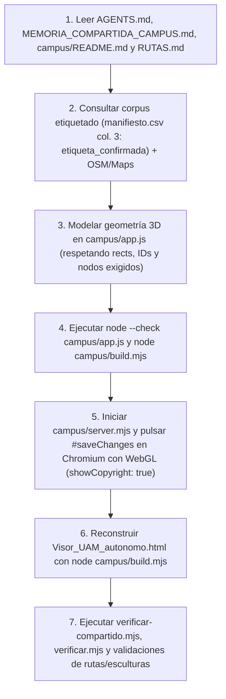

# Metodología e Instrucciones para Agentes de IA · Mejora del Mapa y Modelo 2D/3D de UAM Azcapotzalco

Esta guía documenta la metodología paso a paso utilizada para contrastar, detallar en 3D, exportar y verificar el modelo de **UAM Azcapotzalco**, de modo que cualquier otro agente de IA (Claude, Codex, Gemini, etc.) pueda retomar o ampliar el trabajo sin romper los contratos de las apps móviles ni los verificadores del repositorio. También quedó guardada en el repositorio de trabajo en [campus/METODOLOGIA_MEJORA_IA.md](./METODOLOGIA_MEJORA_IA.md).

---

## 1. Flujo de trabajo general para otra IA



---

## 2. Arquitectura de archivos e invariantes del contrato

| Archivo | Rol | Regla para la IA |
|---|---|---|
| [campus/app.js](./app.js) | Fuente principal 3D/2D (Three.js) | Aquí se programan todos los generadores de edificios, plazas, rampas, canchas, mobiliario y cámaras. |
| [campus/campus_editado.json](./campus_editado.json) y [campus/model-data.js](./model-data.js) | Datos estructurados del campus | Conservar los 26 IDs de edificios, los 6 accesos (`gates`), `T.noStreetExit: true` y `showCopyright: true`. |
| [campus/georreferencia.json](./georreferencia.json) | Esquinas GPS del PNG | **Inmutable** (`1560×640`, `metrosPorUnidad: 1.0895`). No girar ni recortar el plano. |
| [campus/rutas.json](./rutas.json) | Red peatonal (115 nodos, 120 tramos, 31 destinos) | Conservar coordenadas e IDs (`P1..P3` edificios vs `ACCESO_P1..P3` puertas; `T` en `n89`). **Nunca ejecutar `generar-rutas.mjs --write`**. |
| [campus/Visor_UAM_autonomo.html](./Visor_UAM_autonomo.html) | Visor portátil sin servidor | **Nunca editar a mano**; siempre regenerarlo con `node campus/build.mjs`. |
| `UAM_Azcapotzalco.glb`, `plano_2d.png` y `*_sin_marca.*` | Activos consumidos por KMP y Flutter | Exportarlos siempre desde el visor (`#saveChanges`) con `server.mjs` corriendo. |

---

## 3. Sistema de coordenadas: cómo posicionar elementos con precisión

En [campus/app.js](./app.js#L30-L32):
```js
const S = () => data.metersPerPixel; // 740/1670 = 0.4431137724550898 unidades de modelo por píxel
const X = px => (px - 895) * S();    // +X = Este (hacia canchas), -X = Oeste (hacia Av. San Pablo)
const Z = py => (py - 390) * S();    // +Z = Sur (hacia Eje 5 Norte), -Z = Norte (hacia estacionamientos)
```
- **Altura vertical (`Y`):** cada nivel mide `data.storeyHeight = 3.3 m`.
- **Coordenadas locales dentro de `building(b)`:**
  Cada volumen `part` (`<ID>_volumen_<idx>`) está centrado en `(X((r[0]+r[2])/2), 0, Z((r[1]+r[3])/2))` con dimensiones `w = (r[2]-r[0])*S()` y `d = (r[3]-r[1])*S()`:
  - Lado -Z del modelo: `z = -d/2`
  - Lado +Z del modelo: `z = +d/2`
  - Lado -X del modelo: `x = -w/2`
  - Lado +X del modelo: `x = +w/2`
- **Encuadre del PNG 2D (`1560×640`):**
  `PLANO = { xMin: -390, xMax: 390, zMin: -150, zMax: 170, pxPorMetro: 2 }`.

---

## 4. Cómo consultar el corpus fotográfico (`solo_caras`)

El corpus autorizado está en [entrenamiento/corpus/uam/solo_caras/](../entrenamiento/corpus/uam/solo_caras/README.md):

> [!TIP]
> En [corpus/manifiesto.csv](../entrenamiento/corpus/uam/solo_caras/corpus/manifiesto.csv), la columna `clase_modelo` (índice 2) sólo distingue `T`, `I`, `G`, `W`, `P2`, `otro`, `interior` y `excluida`. Para obtener la etiqueta específica de los **21 edificios y zonas confirmados** (`P1`, `P3`, `P4`, `HO`, `H`, `E`, `F`, `J`, `L`, `M`, `Q`, `R`, `S`, `A`, `COSEI`, `plaza_roja`, `area_deportiva`, etc.), **lee siempre la columna `etiqueta_confirmada` (índice 3)** y `es_interior` (índice 4).

### Checklist de observación arquitectónica por foto
1. **Alturas y niveles:** contrastar `b.floors` con los niveles reales (p. ej. `P1`, `P2` y `P3` tienen 2 niveles, mientras `P4` tiene 4 niveles).
2. **Pasos abiertos en planta baja:** si un edificio tiene un túnel o paso abierto de lado a lado (como el **único cuadro central `bay === 3` de `G`** entre Plaza COSEI y Plaza Roja en `imagen_0080.png` y `0086.png`), **no usar una caja continua `Cuerpo de concreto`**; dividir el edificio en dos bloques (`norte` y `sur`) dejando libre el vano central tanto en muros como en ventanas y faldones.
3. **Rampas, escaleras y techumbres:** identificar rampas de acceso (`T`, `G`, `COSEI`, `W`, `P1`, `P2`, `P3`, `P4`, `E`, `J`, `M`, `R`), cubiertas curvas o abovedadas (`T`, `P3`, `F`), lucernarios piramidales (`J`) y pórticos (`W`, `I`, `P4`).
4. **Hitos visuales de orientación:** letras volumétricas rojas (`t`, `i`, `2P`, `j`, `e`, `r`), torre de azulejo azul (`P1`), árbol amarillo de conexiones de acero (`P4`), tótems de cicloestacionamiento (`T`), bancas curvas (`Caracol_COSEI` y `Plazuela_bancas_curvas_J`), gradas techadas y frontón (`Q`/canchas).

---

## 5. Cómo diseñar y mantener los estacionamientos sin aliasing subpíxel en 2D/3D

> [!IMPORTANT]
> En `planoBlob()`, la cámara ortográfica proyecta un marco de `780 m × 320 m` en una imagen de `1560×640 px` (`1 m = 2 px`, es decir **`1 px = 0.50 m`**). Si se dibujan líneas de cajón demasiado delgadas (p. ej. `0.055 m = 0.11 px`) con un paso constante múltiplo exacto de `0.50 m` (como `2.50 m = 5.0 px`), todas las líneas de un mismo estacionamiento caen exactamente en la **misma fase subpíxel** `((X + 390) * 2) mod 1` y desaparecen por completo en `plano_2d.png` cuando dicha fase no coincide con el centro de muestreo del píxel.

### Reglas técnicas implementadas en `parkingArea()` y `vialidadEstacionamientos()` ([campus/app.js](./app.js#L1060-L1200))
1. **Grosor y paso anti-aliasing para `plano_2d.png`:**
   - Usar un grosor mínimo de **`0.26–0.28 m` (`> 0.5 px`)** para las líneas divisorias (`Cajón`), líneas de cabecera (`Linea_cabecera_bateria`) y líneas discontinuas de carril (`Linea_carril_vial`), y **`0.48 m` (`~1 px`)** para las guarniciones perimetrales (`Guarnicion_estacionamiento`).
   - Usar un ancho de cajón de **`2.70 m` (`5.4 px`)** de modo que la fase subpíxel rote cajón tras cajón y nunca sufra desaparición periódica.
2. **Jerarquía de alturas `Y` (prevención de *z-fighting*):**
   - `Asfalto`: `y = 0.15, h = 0.24` (tope en `0.27 m`)
   - `Carril_circulacion_interna` / `Carril_vial_conexion`: `y = 0.285–0.295, h = 0.025–0.03` (tope en `~0.31 m`)
   - `Cajon_accesible_azul`: `y = 0.295, h = 0.025`
   - `Linea_carril_vial`: `y = 0.315–0.32, h = 0.03`
   - `Cajón` y `Linea_cabecera_bateria`: `y = 0.325, h = 0.04` (tope en `0.345 m`)
   - `Guarnicion_estacionamiento`, `Camellon_estacionamiento` y `Tope_cajon`: tope en `0.39–0.41 m`
3. **Exclusión espacial automática (`blocked(lx, lz)`):**
   - Antes de instanciar cada cajón o poste en coordenadas locales `(lx, lz)`, conviértelo a coordenadas de croquis `(px, py)` y verifica que no invada:
     - Ningún edificio de `data.buildings` (`Edificio A` dentro de `parking_0` queda aislado mediante su propia `Explanada_obra_A` y `Guarnicion_obra_A`; `H`, `HO`, `HP`);
     - Ninguna plazoleta de escultura (`Serpentina II` en `[824, 265]`, `Casa abierta al tiempo` y `Universitas` en `parking_2`);
     - Los carriles troncales de circulación norte (`py ∈ [190, 214]`) y sur (`py ∈ [616, 638]`).
4. **Continuidad vial y control de accesos (`vialidadEstacionamientos()`):**
   - Conecta los accesos vehiculares `V1` (`[66, 220]`), `V2` (`[66, 626]`) y `V3` (`[1485, 235]`) mediante carriles con línea amarilla discontinua, casetas de vigilancia (`Caseta_vigilancia_V1..V3`), plumas (`Pluma_vehicular_V1..V3`), pasos peatonales de cebra (`Paso_peatonal_estacionamiento`) y el estacionamiento oriente frente a `W` y `R` (`Estacionamiento_W_R`, con guarnición amarilla y tambos naranjas según `imagen_0060.png`).

---

## 6. Invariantes de los verificadores que otra IA debe respetar

Antes de dar por terminado cualquier cambio, verificar que el GLB cumpla estas condiciones exigidas por [campus/verificar.mjs](./verificar.mjs), [campus/verificar-compartido.mjs](./verificar-compartido.mjs), [campus/verificar-esculturas.mjs](./verificar-esculturas.mjs) y [verificar-rutas.mjs](../verificar-rutas.mjs):

- **`Edificio_G`:** grupo `Refuerzos_estructurales_G` con 2 fachadas (`Fachada_reforzada_Plaza_Roja` y `Fachada_reforzada_COSEI`) y **`>= 40` nodos `Diagonal_roja_G` en cada fachada**.
- **`Edificio_T`:** grupo `T_AZC_fachada_y_escalera`, **`>= 12` nodos `T_peldano_exterior`**, `T_pasamanos_rojo_escalera`, `T_muro_inclinado_terracota`, `T_barandal_rojo_galeria`, `T_marquesina_curva_aproximada`, `T_rotulo_rojo`, `T_explanada_interior`.
- **`Edificio_HO` y `Edificio_HP`:** exactamente **4 nodos `Antepecho_curvo_`** (`0..3`), **2 nodos `Cubierta_translúcida_superior`** (`alphaMode: 'BLEND'`), `Cercha_amarilla` y ningún `Remate cuadrado`.
- **`Plaza_COSEI_detalle`:** exactamente **6 nodos `Escalón_COSEI_1..6`** con cotas ascendentes hasta `baseElevation + rise`, **2 nodos `Jardinera_COSEI_0..1`**, `Asta_bandera_COSEI` (`height: 18`), `Mástil` de `18 m` y `Bandera_México` con textura incrustada.
- **`Marca_copyright_modelo`:** `showCopyright: true` activo al exportar, produciendo **exactamente `34` nodos de diferencia** entre `UAM_Azcapotzalco.glb` y `UAM_Azcapotzalco_sin_marca.glb` (`33` paneles `Copyright_integrado_0..32` alineados a `campusNorth`).
- **Colisiones de rutas (`route-space.js`):** cualquier anexo nuevo (como el ala norte en L de `T` o el patio cubierto de `P4`) debe agregarse como malla 3D en `app.js` sin expandir `b.rects` sobre los andadores de `rutas.json`, manteniendo `routeIssues(net, data, geo).length === 0`.

---

## 7. Exportación y capturas desde el visor

1. Iniciar `campus/server.mjs` y abrir su URL local en el navegador.
2. Comprobar el estado de la marca de agua y pulsar **Guardar cambios**. Esperar el mensaje de que se guardaron campus, rutas y variantes con/sin marca.
3. Reconstruir el portátil con `node campus/build.mjs`; comparar rutas y georreferencia con el respaldo sin descartar cambios ajenos.
4. Ejecutar los verificadores actuales y revisar visualmente plano, fachadas y accesos. Documentar por separado las comprobaciones históricas que ya fallaban antes de esta revisión.

## Revisión Codex · 17 noviembre 2026

- Escala real de los datos: `metersPerPixel = 740/1670 = 0.4431137724550898`. Las unidades del modelo no son una nueva medición física. No aplicar la cifra 0.375 que contenía la versión inicial de esta guía ni inferir cardinales de X/Z; usar las esquinas geográficas y `campusNorth`.
- Georreferencia, huellas e IDs, siete estacionamientos y red peatonal permanecen intactos. Los detalles de geometría también deben respetar los accesos: no basta comprobar rutas contra los rectángulos si un antepecho o un volumen nuevo invade el recorrido.
- Las reglas de trazo mínimo y separación 2.7 son de legibilidad en el PNG, no un levantamiento del número o posición de cajones. No ubicar automáticamente plazas reservadas como si estuvieran verificadas.
- No seguir las antiguas instrucciones de automatización por consola del navegador o restauración con `git checkout`. Para esta revisión se utiliza el visor y sus botones, se conservan respaldos y se verifican los exports generados.
- La carpeta original de Gemini y su documentación se conservan en el respaldo previo. Los cambios de este trabajo y su evidencia se detallan en `EVIDENCIA_DETALLES_2026-11-17.md` y el informe de revisión del mapa.
